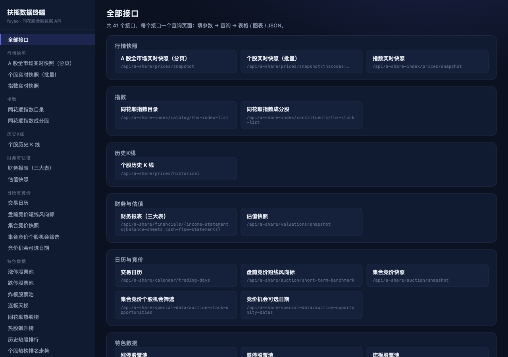

# fuyao_demo · 扶摇数据查询终端

**查 A 股数据的网页工具——不写代码，选功能、填参数、点查询。**

覆盖行情快照、历史 K 线、涨停/热股/龙虎榜、财务估值、基金等 41 项数据，来源为同花顺官方 API（扶摇）。

## 按需入口

| 你是谁 / 你想做什么 | 去这里 |
|---|---|
| 👤 **我想查数据，不写代码** | [使用指南 →](usage.md)（含界面截图与术语表） |
| 🔧 **我想把项目跑起来** | [部署运维 →](deployment.md)（两种模式，最简一条命令） |
| 🧑‍💻 **我想读懂/修改代码** | [架构设计 →](architecture.md)（注册表驱动，~2200 行全解） |
| ➕ **我想加一个新接口页** | [扩展指南 →](extending.md)（3 分钟 3 步） |
| 📖 **我要查接口参数/错误码** | [接口目录 →](endpoints.md)（41 接口自动生成）· [契约手册 →](api-contract.md) |

## 一图看懂

```text
┌──────────────┐   GET /api/meta（注册表）    ┌───────────────────┐
│   前端 React  │ ◄────────────────────────── │  Flask 后端        │
│  EndpointPage │                              │  playground 蓝图   │
│  （通用查询页）│  GET /api/playground/<id>   │  （参数白名单）     │
│              │ ──────────────────────────► │        │           │
└──────────────┘   只放行注册表声明的参数       └────────▼──────────┘
                                              fuyao_client.py
                                              （认证/信封/节流/时区）
                                                   │
                                                   ▼
                                          fuyao.aicubes.cn REST
```

## 界面预览



> 完整截图与操作说明见[使用指南](usage.md)。
