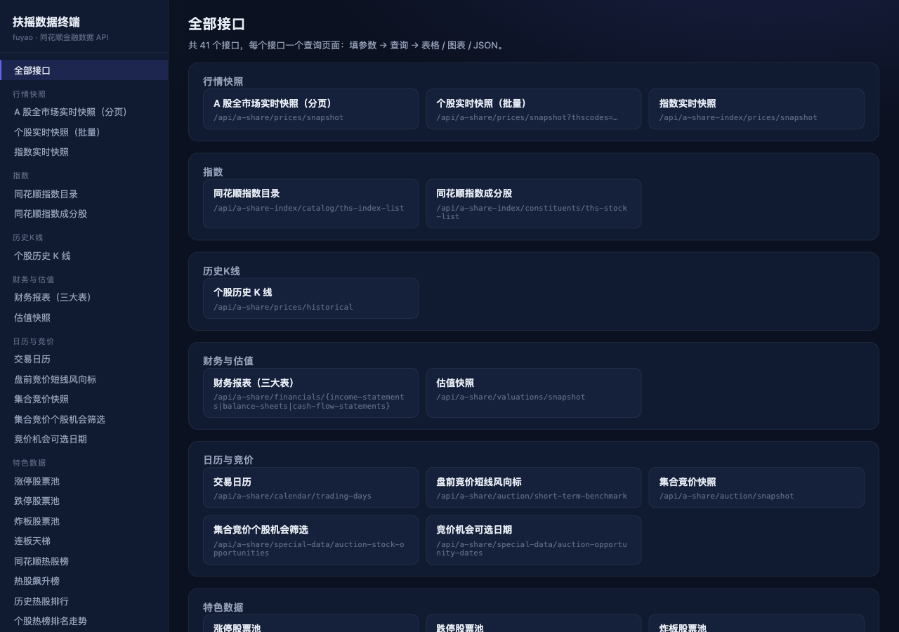
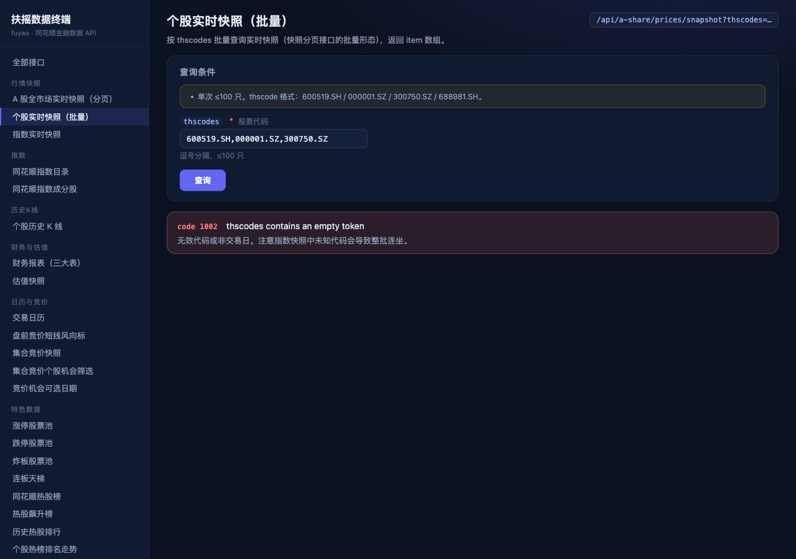
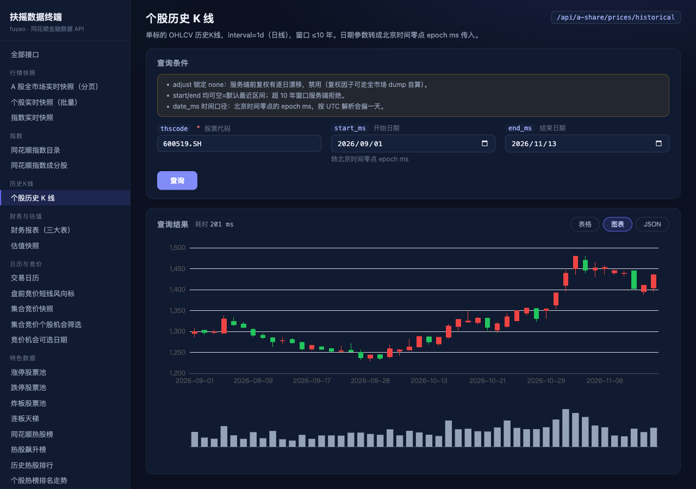

# 使用指南（无需编程）

## 这是什么？

一个**查股票数据的网页工具**。你不需要写任何代码——像用任何网站一样：左边选功能 → 填几个框 → 点「查询」→ 看表格或图表。

它能查 41 种数据，覆盖日常看盘常用场景：

| 你想知道… | 用这个功能 |
|---|---|
| 某几只股票现在什么价 | 行情快照 → 个股实时快照（批量） |
| 某只股票的历史走势 | 历史K线 → 个股历史 K 线 |
| 今天哪些股票涨停了 | 特色数据 → 涨停股票池 |
| 现在市场在炒什么 | 特色数据 → 同花顺热股榜 / 热股飙升榜 |
| 某只基金表现如何 | 基金 → 基金区间收益与排名 / 基金最大回撤 |
| 今天是不是交易日 | 日历与竞价 → 交易日历 |

## 界面长什么样？

**首页 = 功能目录**。左边是按类别分组的全部 41 个功能，中间是同样的功能卡片，点任何一个进入查询页：



**查询页 = 填表 → 点查询**。表单已经帮你填好了示例（比如默认的股票代码），不改也行，直接点「查询」：



结果有三个页签可以切换：

- **表格** —— 整齐的数据列表（最常用）
- **图表** —— K 线、条形图等（部分功能有）
- **JSON** —— 原始数据（给技术同学核对用，可以无视）

有图表的功能长这样（贵州茅台日 K 线）：



## 第一次使用：三步上手

1. **拿到钥匙**：在 https://fuyao.aicubes.cn 注册并申请一个 API Key（一串字符，相当于你的通行证，按量计费/有免费额度以官方为准）
2. **启动工具**：需要会电脑的同事/朋友帮忙执行一次（见下方「启动」），之后就是一个普通网页
3. **开始查**：按上面的「你想知道…」表格找到功能，点查询

## 启动（给帮忙执行的人）

```bash
cd backend && .venv/bin/python app.py     # 启动后浏览器打开 http://127.0.0.1:5010
```

前提：`backend/.env` 文件里已填好 `FUYAO_API_KEY=你的key`（只需配一次）。详细步骤见[部署运维](deployment.md)。

## 术语表

| 术语 | 白话解释 |
|---|---|
| thscodes / 股票代码 | 股票的"身份证号"，如 `600519.SH` 是贵州茅台（`.SH`=上海，`.SZ`=深圳） |
| 快照 | 某一时刻的全市场报价"照片" |
| 批量 | 一次同时查多只（有限制，一般 ≤100 只，页面会提示） |
| K 线 | 蜡烛图，一根蜡烛表示一天的开盘价/收盘价/最高/最低 |
| 净值 | 基金每份值多少钱 |
| 回撤 | 从高点最多跌了多少（衡量基金"惨"的程度） |
| 龙虎榜 | 交易所公布的异动股票买卖席位明细 |
| 炸板 | 涨停后又被打开（封住涨停叫"封板"） |

## 常见问题

**查询报红色错误提示怎么办？**

看提示里的文字，最常见的三种：

- `no_key` —— 还没配 API Key，找帮忙的人配置 `backend/.env`
- `4001 请求过于频繁` —— 点太快了，等几秒再点
- `1002 无效代码或非交易日` —— 股票代码写错了，或者查询的那天股市不开门（周末/节假日）

**为什么日期总是"差一天"？**

不是 bug——数据源的日期是按北京时间记录的，系统内部已自动处理；如果自己写程序解析原始 JSON 才需要注意（见[契约手册](api-contract.md#时间口径)）。

**数据准吗？**

数据来自同花顺官方 API（扶摇），与同花顺 App 同源。

**能查美股/港股吗？**

目前仅覆盖 A 股、场内外基金、同花顺指数。
